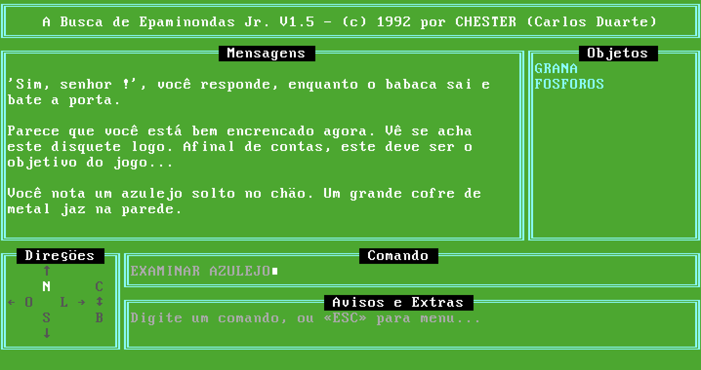
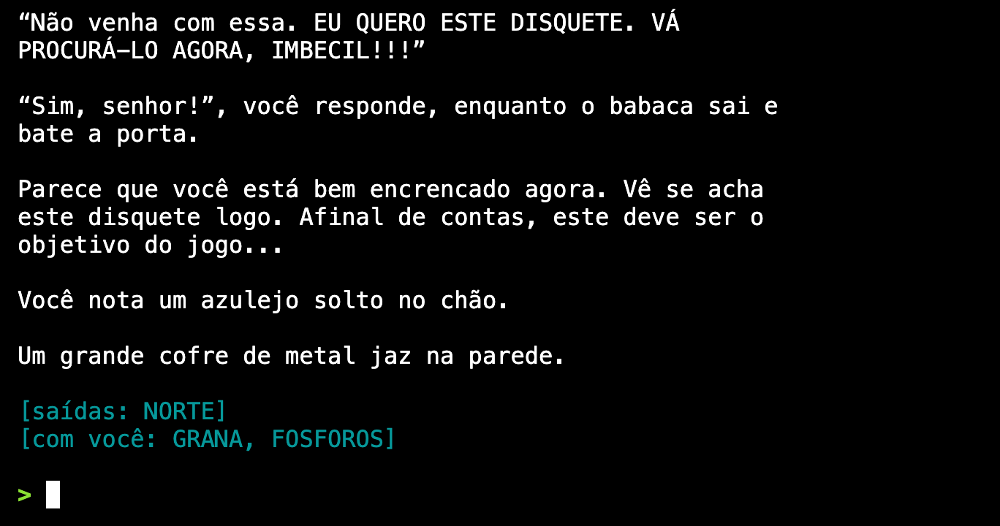

# A Busca de Epaminondas Jr.

Em 1992 eu publiquei este adventure de texto para MS-DOS, feito em Turbo Basic 1.0: você é Epaminondas e precisa achar o disquete do seu chefe para não perder o emprego. Na época eu não conhecia o conceito de software livre, então distribuí nas BBSes só o executável, e o código-fonte acabou se perdendo.

Com a popularização recente de ferramentas como o [REA](https://github.com/morluto/rea), resolvi experimentar fazer o disassembly e a reconstrução desse código-fonte, assistido por IA. Este repositório documenta o processo e hospeda os frutos dele:

- **[LEGIVEL.BAS](basic/gerado/LEGIVEL.BAS)**: o código-fonte do jogo, amplamente comentado e num formato próprio para humanos.
- **[CA1.BAS](basic/gerado/CA1.BAS)**: uma versão mais próxima do que seria o original, que gera o executável original idêntico byte a byte.
- **[epa.py](python/epa.py)**: uma implementação de referência que recria o jogo como um aplicativo de linha de comando, num formato mais confortável de jogar.

Além disso, aqui é possível:

- [Jogar o original no navegador](https://chester.me/a-busca-de-epaminondas-jr/original.html) (via [js-dos](https://js-dos.com/), um DOSBox em WebAssembly)
- [Jogar a versão Python no navegador](https://chester.me/a-busca-de-epaminondas-jr/python.html) (via [Pyodide](https://pyodide.org/) e [xterm.js](https://xtermjs.org/))

<table align="center">
<tr>
<td></td>
<td></td>
</tr>
<tr>
<td align="center">O original (DOSBox-X)</td>
<td align="center">A versão Python (terminal)</td>
</tr>
</table>

> **In English:** this is a 1992 Brazilian Portuguese text adventure written in Turbo Basic 1.0, whose source code was lost because I only ever distributed the executable. With AI assistance I disassembled it and rebuilt the source: this repository has a readable, commented Turbo Basic version, a second one that recompiles to a byte-identical executable, and a faithful Python reimplementation checked against the original running in DOSBox-X, plus the original DOS files, the reverse-engineering notes and memory dumps. You can play [the original](https://chester.me/a-busca-de-epaminondas-jr/original.html) and [the Python version](https://chester.me/a-busca-de-epaminondas-jr/python.html) in the browser. The game is in Portuguese only.

## Jogar localmente

A reimplementação em Python não tem dependências (Python 3.9 ou mais novo):

```
python3 python/epa.py
```

Para rodar um roteiro de comandos (um por linha) em vez de digitar:

```
python3 python/epa.py python/caminhos/00_caminho_feliz.txt
```

O `00_caminho_feliz.txt` é a solução completa, comentada.

Para jogar o original, use o DOSBox (ou DOSBox-X). Na raiz do repositório, este comando monta `original/` como `C:` e roda `AVENTURA.BAT`, que mostra a abertura (`CHESTER.EXE`) e depois chama o jogo:

```
dosbox -c "mount c original" -c "c:" -c "aventura.bat"
```

Para ir direto ao jogo, sem a abertura, troque o último comando por `-c "ca1.exe"`. Os jogos gravados (`*.CA1`) vão para a pasta montada.

## Engenharia reversa

Foi conduzida com o Claude Code, com estas ferramentas:

- Um decodificador próprio em Python (com [capstone](https://www.capstone-engine.org/)) para desmontar o `CA1.EXE`, que tem chamadas ao runtime com operandos embutidos (`basic/gerar.py`).
- O DOSBox-X e seu depurador (`BPINT`, `MEMDUMPBIN`), para extrair a memória do jogo rodando e comparar o original com a reimplementação.
- O Turbo Basic 1.0 ([WinWorld](https://winworldpc.com/product/turbo-basic/1x)), para compilar programas de teste e descobrir o que o compilador gera (`basic/rosetta/`).

Comece por `docs/engenharia-reversa.md`, que tem os detalhes.

## O que tem aqui

| Pasta | Conteúdo |
|---|---|
| `original/` | Os arquivos de 1992 (`CA1.EXE`, `CHESTER.EXE`, `AVENTURA.MSG`, `AVENTURA.BAT`, `LEIAME.TXT`), com `SHA256SUMS`, o `epa15.zip` de onde saíram (https://chester.me/download/epa15.zip; guarda as datas originais dos arquivos) e cópias em UTF-8 dos textos |
| `analise/` | Engenharia reversa: dumps de memória, listagem do código, tabelas e pseudocódigo de salas e verbos |
| `python/` | A reimplementação em Python, os 45 roteiros de teste e as saídas esperadas |
| `web/` | As duas páginas para jogar no navegador (`original.html` e `python.html`) e o `montar.py`, que monta o site publicado no GitHub Pages |
| `docs/` | Como o jogo funciona por dentro, e os testes feitos no original |
| `ferramentas/dosbox/` | Scripts (macOS) que pilotam o original no DOSBox-X para comparar com a reimplementação |
| `basic/` | O fonte Turbo Basic reconstruído (`gerado/CA1.BAS`, que recompila para o mesmo código do `CA1.EXE`, e `gerado/LEGIVEL.BAS`, para ler), o gerador a partir do executável e a "Pedra de Roseta" do compilador (`rosetta/`) |

## Testes

Um comando roda tudo (os 45 roteiros contra as saídas esperadas, mais a conferência dos textos):

```
python3 python/testar.py
```

As saídas esperadas foram conferidas contra o original rodando no DOSBox-X (ver `python/caminhos/LEIA.md`). Se uma mudança de comportamento for de propósito, `python3 python/testar.py --atualizar` regrava as saídas e o diff do git mostra o que mudou.

## Fidelidade e diferenças

A reimplementação segue o original, bugs inclusive. As diferenças são poucas e propositais, e estão listadas em `docs/engenharia-reversa.md` e `python/erratas.md`: os textos foram modernizados (acentos, aspas, pontuação; o original usava CP437, sem `ã` e `õ`), e dois erros óbvios foram corrigidos (a frase "MESMO ???", engolida por um bug, e `LER PLACA` no elevador). O `MENU` do jogo não foi reimplementado.

## Licença

Código, ferramentas e documentos deste repositório: [MIT](LICENSE). O jogo original é de domínio público, por declaração minha em `original/AVENTURA.BAT` ("Este é um programa de domínio público. A cópia é livre e autorizada.").
